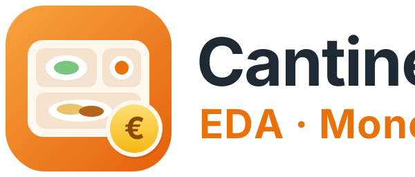
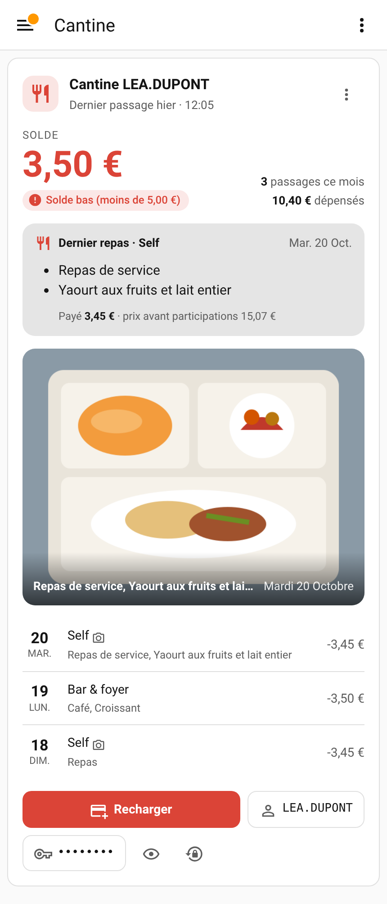

<p align="center"></p>

# Cantine EDA (Moneweb) pour Home Assistant

Intégration Home Assistant pour les comptes de cantine gérés sur un portail **Moneweb**
(par exemple `eda-arcueil.moneweb.fr`) : solde, passages, photo du dernier plateau,
alerte de solde bas, rechargement en un clic et gestion du mot de passe.

<p align="center"></p>

## Fonctionnalités

- **Plusieurs comptes** : ajoutez l'intégration une fois par enfant / par carte.
- **Chaque passage avec son lieu** (Self, Bar & foyer, Restauration rapide) et **ce qui a été consommé**,
  lu sur le ticket de caisse.
- **Dernier repas** : produits, montant payé, prix avant participations et détail des participations.
- **Photo du dernier plateau** (entité `image`), quand le self en a pris une.
- **Capteurs** par compte : solde, dernier passage, dernier repas, lieu du dernier passage, prix du dernier repas,
  dépenses et passages du mois, dernier rechargement, expiration du mot de passe, solde bas (binaire).
- **Carte Lovelace** incluse et chargée automatiquement (`custom:cantine-eda-card`), avec éditeur visuel.
- **Bouton « Recharger »** : ouvre la page de rechargement dans le navigateur et copie le mot de passe
  dans le presse-papier, comme un gestionnaire de mots de passe.
- **Mot de passe** : le site le fait expirer (environ tous les 90 jours) ; l'intégration le **renouvelle
  automatiquement 7 jours avant**, sans risque de perte, et permet de le récupérer à tout moment.
- Réauthentification guidée si le site refuse le mot de passe, diagnostics téléchargeables.

## Installation

### HACS (recommandé)

1. HACS → menu ⋮ → **Dépôts personnalisés** → ajoutez `https://github.com/globoudou/home-assistant-cantine-eda`, catégorie **Intégration**.
2. Installez **Cantine EDA (Moneweb)** puis redémarrez Home Assistant.
3. **Paramètres → Appareils et services → Ajouter une intégration → Cantine EDA**.

### Manuelle

Copiez `custom_components/cantine_eda` dans le dossier `config/custom_components/` puis redémarrez.

Home Assistant 2025.2 minimum. L'icône de l'intégration s'affiche à partir de Home Assistant 2026.3
(images embarquées dans `custom_components/cantine_eda/brand/`).

## Configuration

| Champ | Exemple |
|---|---|
| Adresse du site | `eda-arcueil.moneweb.fr` |
| Identifiant | celui de l'espace client |
| Mot de passe | celui de l'espace client |
| Vérifier le certificat SSL | coché ; décochez seulement si la connexion échoue à cause du certificat |

Ajoutez l'intégration une seconde fois pour un autre compte.

### Options (⚙️ sur l'entrée)

**Général** : intervalle de mise à jour, seuil de solde bas, page de rechargement,
modèle d'URL de la photo, autorisation des non-administrateurs à copier le mot de passe.

**Renouvellement du mot de passe** : nombre de jours avant l'expiration (7 par défaut, 0 = jamais),
renouvellement périodique en plus (0 = jamais), longueur, symboles, endpoint et corps JSON du changement.

## Carte

La carte est enregistrée automatiquement : l'intégration l'ajoute elle-même aux ressources des
tableaux de bord (mode « stockage », le mode par défaut) et met cette ressource à jour à chaque
version. **Ajouter une carte → Cantine EDA**. En YAML :

```yaml
type: custom:cantine-eda-card
entity: sensor.cantine_xxx_solde
title: Cantine de Léa          # facultatif
show_last_meal: true           # produits du dernier ticket
show_photo: true
show_tickets: true
tickets: 5
show_credentials: true          # boutons identifiant / mot de passe
copy_password_on_recharge: true
```

**Recharger** copie le mot de passe puis ouvre le site : il ne reste qu'à coller.
L'œil affiche le mot de passe 20 secondes. ↻ renouvelle le mot de passe (administrateurs,
si le renouvellement est configuré). La copie automatique nécessite que Home Assistant soit
servi en HTTPS ; sinon utilisez l'œil.

## Mots de passe

Les mots de passe sont stockés comme ceux de toutes les intégrations, dans `.storage/core.config_entries`
(fichier non chiffré : protégez vos sauvegardes).

| Action | Rôle |
|---|---|
| `cantine_eda.get_password` | Renvoie identifiant, mot de passe courant, précédent et en cours de changement. Administrateurs ou automatisations uniquement. |
| `cantine_eda.renew_password` | Change le mot de passe sur le site (aléatoire, ou celui fourni) puis le vérifie. |
| `cantine_eda.set_password` | Vous avez changé le mot de passe vous-même sur le site : il est vérifié puis enregistré. |

Exemple dans **Outils de développement → Actions** (cochez « Retourner la réponse ») :

```yaml
action: cantine_eda.get_password
data:
  config_entry_id: 01J...   # choisi dans la liste
```

### Renouvellement sans risque de perte

1. Le nouveau mot de passe est enregistré dans Home Assistant **avant** l'appel au site.
2. Le site est appelé, puis l'intégration **se reconnecte avec le nouveau mot de passe** pour vérifier.
3. Succès : il devient le mot de passe courant, l'ancien est conservé comme « précédent ».
4. Échec : si l'ancien fonctionne toujours, rien ne change ; sinon les deux sont conservés,
   une alerte apparaît dans **Réparations** et l'action `get_password` permet de les récupérer.
5. Si Home Assistant s'arrête au milieu, au redémarrage l'intégration essaie aussi le mot de passe
   « en cours » et le « précédent » avant de demander une réauthentification.

Le renouvellement automatique a lieu 7 jours avant la date d'expiration annoncée par le site
(capteur « Expiration du mot de passe »), ou immédiatement si le site exige un changement.
Un événement `cantine_eda_password_renewed` est émis après chaque renouvellement réussi.

## API Moneweb utilisée

Relevée sur `eda-arcueil.moneweb.fr` (portail JES Moneweb 2.5). Rien n'est à configurer.

| Appel | Usage |
|---|---|
| `POST /clients/api/sign/in` `{"ID", "Password", "RememberMe"}` | Connexion. Renvoie `ChangePassword` et `PasswordExpireDate`. |
| `POST /clients/api/compte/dashboard` | Solde, tickets (`Tickets.List` : `IdTicket`, `IdCommande`, `DateTicket`, `Activite`, `AncienSolde`, `NouveauSolde`, `TotalPlateau`…), rechargements (`Versements.List`) et photos (`SubModels.Asa.Pictures`, indexées par `IdCommande`). |
| `GET /clients/api/ticket/display/{IdTicket}` | Ticket de caisse en HTML : produits, total, participations. Lu une seule fois pour les 5 derniers passages. |
| `GET /clients/api/acquisition/{id}` | Photo du plateau (JPEG). |
| `POST /clients/api/password` `{"OldPassword", "NewPassword", "ConfirmPassword"}` | Changement du mot de passe (réponse 200 vide). |

Sur un autre portail Moneweb, l'endpoint et le corps du changement de mot de passe restent modifiables
dans les options. La **page de rechargement** peut aussi y être précisée : par défaut, c'est l'accueil
de l'espace client.

Les **diagnostics** de l'appareil (⋮ → Télécharger les diagnostics) contiennent la réponse du site
anonymisée et ce que l'intégration y a détecté : c'est le plus utile pour ouvrir une issue.

## Exemple d'automatisation

```yaml
triggers:
  - trigger: state
    entity_id: binary_sensor.cantine_xxx_solde_bas
    to: "on"
actions:
  - action: notify.mobile_app_mon_telephone
    data:
      title: Cantine
      message: "Solde bas : {{ states('sensor.cantine_xxx_solde') }} €"
      data:
        url: "{{ state_attr('sensor.cantine_xxx_solde', 'url_rechargement') }}"
```

## Développement

```bash
pip install pytest-homeassistant-custom-component home-assistant-frontend
pytest
```

Les tests démarrent un faux portail Moneweb local et couvrent l'ajout de compte, les entités,
la photo, la récupération et le renouvellement du mot de passe (succès, échec, reprise après coupure)
et la réauthentification.

Projet indépendant, non affilié à Moneweb ni à la ville.
